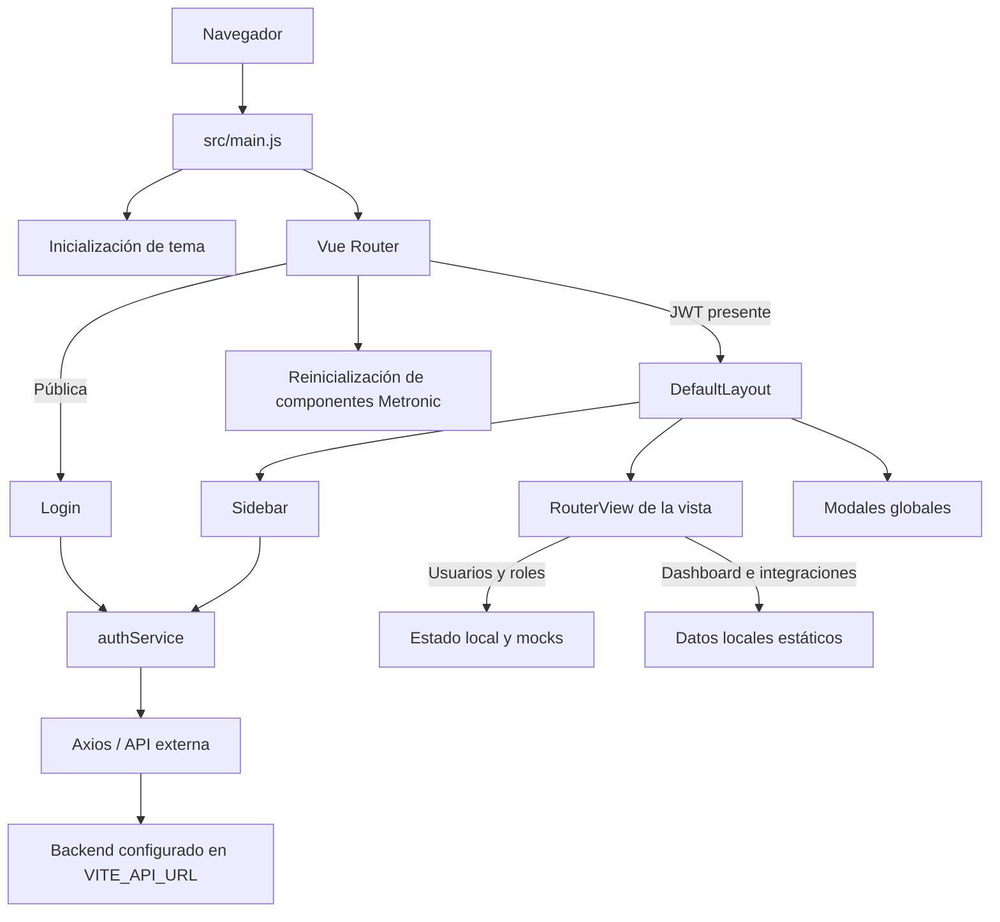
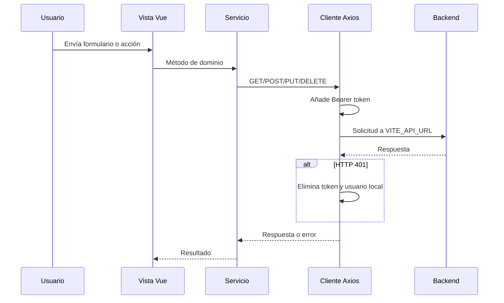

# Mapeo técnico del proyecto SEDALP

## 1. Alcance del análisis

Este documento describe la estructura, arquitectura, áreas funcionales, rutas, estado, persistencia y flujos observados en el repositorio. El análisis se actualizó sobre la rama `main`, partiendo del commit `1aaea72` (`features: restructuracion de archivos segun las mejores practicas`) y un árbol de trabajo limpio. El inventario se obtuvo con `git ls-files --cached --others --exclude-standard` y se filtró a rutas existentes, por lo que solamente se analizaron archivos rastreados por Git o archivos no ignorados.

No se inspeccionaron `node_modules/`, `dist/`, archivos locales, logs, cobertura ni otros elementos excluidos por `.gitignore`. La compilación de verificación creó `dist/`, pero su contenido no forma parte de este análisis.

## 2. Resumen ejecutivo

SEDALP es una aplicación web SPA (Single Page Application) de frontend construida con Vue 3 y Vite. Usa Vue Router para navegación, Axios para comunicarse con una API externa, Tailwind CSS 4 y el tema Metronic 9/KTUI para la interfaz.

La aplicación organiza las páginas asociadas a Vue Router bajo `src/views/`, agrupadas por área funcional: autenticación, control de acceso, dashboard, comunicación, cuenta y perfil público. Las rutas se definen de forma centralizada en `src/router/index.js`; los servicios están en `src/services/`, los mocks en `src/mocks/` y la UI compartida en `src/components/ui/`.

La autenticación y el cierre de sesión son los únicos flujos conectados explícitamente con la API. Las pantallas de usuarios y roles operan con datos simulados en memoria, aunque existen servicios CRUD preparados para el backend. El dashboard ya presenta contenido institucional de SEDALP, pero sus métricas y estados siguen siendo estáticos. Noticias continúa como una vista mínima de prueba.

### Cambios recientes incorporados al mapeo

- Se sustituyó la organización `src/modules/<dominio>/` por carpetas transversales: `views`, `services`, `mocks` y `components`.
- Las rutas que antes estaban repartidas por módulo se centralizaron en `src/router/index.js`.
- Se corrigió el contrato de importación de `userService` y `roleService` para usar el export `default` de `api.js`.
- Se creó un dashboard institucional con resumen territorial, accesos rápidos, estado de módulos y actividad reciente.
- Se añadió la ruta protegida `/news` y la carpeta quedó normalizada como `src/views/communication/`.
- La ruta inicial y la redirección posterior al login apuntan ahora a `/dashboard`.



## 3. Tecnologías y dependencias

| Capa         | Tecnología                                       | Uso observado                                        |
| ------------ | ------------------------------------------------ | ---------------------------------------------------- |
| Framework    | Vue `^3.5.40`                                    | Componentes SFC y Composition API con `script setup` |
| Construcción | Vite `^8.1.5`                                    | Servidor de desarrollo y bundle de producción        |
| Navegación   | Vue Router `^5.2.0`                              | Rutas públicas/protegidas y carga diferida           |
| HTTP         | Axios `^1.19.0`                                  | Cliente central y endpoints de autenticación/CRUD    |
| Estilos      | Tailwind CSS `^4.3.3`                            | Utilidades CSS, integrado como plugin de Vite        |
| UI           | Metronic 9, KTUI `^1.2.7`                        | Layout, menús, drawers, modales, iconos y widgets    |
| UI auxiliar  | Pickr, Vanilla Calendar Pro, ApexCharts estático | Recursos disponibles para widgets del tema           |
| Formato      | Prettier `3.9.5`                                 | Formateo de `src/`                                   |

Requisito declarado de Node.js: `^22.18.0` o `>=24.12.0`.

## 4. Árbol lógico

```text
sedalp-project-gadlp/
├── index.html                  # Documento HTML y punto de montaje #app
├── package.json                # Dependencias y scripts npm
├── vite.config.js              # Vue, DevTools, Tailwind y alias @
├── jsconfig.json               # Resolución del alias @/* -> src/*
├── .env                        # Define VITE_API_URL (valor no documentado)
├── public/
│   ├── css/                    # Bundles CSS precompilados del tema
│   ├── js/                     # Scripts precompilados de Metronic
│   ├── media/                  # Iconos, imágenes, avatares y recursos visuales
│   └── vendors/                # Dependencias estáticas del tema
└── src/
    ├── main.js                 # Arranque de la aplicación
    ├── App.vue                 # RouterView raíz
    ├── assets/
    │   ├── main.css            # Entrada de estilos
    │   └── metronic/           # Fuentes y estilos del tema
    ├── router/index.js         # Definición central de rutas y guardas
    ├── services/               # Instancia Axios y servicios de la API
    ├── mocks/                  # Datos simulados para desarrollo
    ├── utils/metronic.js       # Adaptador de Metronic al ciclo de Vue
    ├── layouts/                # Estructura visual de rutas protegidas
    ├── components/ui/          # Componentes visuales reutilizables
    └── views/                  # Páginas asociadas a las rutas
        ├── access-control/
        ├── account/
        ├── auth/
        ├── communication/      # Vista inicial de noticias
        ├── dashboard/
        └── public-profile/
```

El inventario contiene 1.128 archivos existentes y no ignorados: 995 bajo `public/`, 122 bajo `src/`, 10 en la raíz y uno en `.vscode/`. De los 122 archivos de `src/`, 92 pertenecen a `src/assets/metronic/`; quedan 30 archivos para el arranque, router, servicios, mocks, layout, componentes, vistas y estilos propios. Los recursos de Metronic representan aproximadamente 14,9 MB dentro de `src/` y 44,2 MB bajo `public/`.

## 5. Arranque y ciclo de ejecución

1. `index.html` prepara el elemento `#app` y carga `/src/main.js`.
2. `main.js` llama a `initializeTheme()`, que determina modo claro/oscuro desde `localStorage`, un atributo HTML o la preferencia del sistema.
3. Se crea la aplicación Vue y se instala el router.
4. Cuando el router está listo, Vue se monta en `#app`.
5. Después del montaje se cargan secuencialmente scripts estáticos de Metronic:
   - `/js/core.bundle.js`
   - `/vendors/ktui/ktui.min.js`
   - `/vendors/apexcharts/apexcharts.min.js`
   - `/js/widgets/general.js`
6. Después de cada navegación, el router espera el siguiente render de Vue y recrea instancias de menú, dropdown, drawer, modal, tabs y scroll de Metronic.

Esta integración evita que los componentes imperativos del tema pierdan funcionalidad cuando Vue reemplaza el DOM durante la navegación.

## 6. Mapa de navegación

| URL                                | Nombre de ruta           | Vista                          | Acceso        | Título               | En sidebar |
| ---------------------------------- | ------------------------ | ------------------------------ | ------------- | -------------------- | ---------- |
| `/login`                           | `login`                  | `LoginView.vue`                | Solo invitado | Iniciar sesión       | No         |
| `/`                                | —                        | Redirección a `dashboard`      | Protegido     | —                    | Logo       |
| `/dashboard`                       | `dashboard`              | `DashboardView.vue`            | Protegido     | Dashboard            | Sí         |
| `/usuarios`                        | `users.index`            | `UserManagementView.vue`       | Protegido     | Administrar usuarios | Sí         |
| `/roles`                           | `roles.index`            | `RoleManagementView.vue`       | Protegido     | Roles y permisos     | Sí         |
| `/news`                            | `news.index`             | `NewsView.vue`                 | Protegido     | Noticias             | No         |
| `/account/integrations`            | `account-integrations`   | `IntegrationsView.vue`         | Protegido     | Integraciones        | Sí         |
| `/public-profile/profiles/default` | `public-profile-default` | `PublicProfileDefaultView.vue` | Protegido     | Perfil público       | Sí         |
| Cualquier otra                     | —                        | Redirección a `/`              | Según destino | —                    | No         |

Las vistas se importan dinámicamente, de modo que Vite genera un chunk independiente por pantalla. El título del documento sigue el formato `<meta.title> | SEDALP`.

La ruta de noticias existe, pero todavía no tiene una entrada en el sidebar. Además, varios accesos del dashboard usan URLs no declaradas (`/users`, `/regions`, `/staff-members/create`, `/region-assignments` y `/communications/create`); la ruta comodín las devuelve a `/` y finalmente al dashboard. La administración de usuarios realmente vive en `/usuarios`.

### Guardas

- Una ruta bajo `DefaultLayout` hereda `requiresAuth: true`.
- La autenticación se considera válida si existe `access_token` en `localStorage`; no se valida aquí su expiración.
- Sin token, una ruta protegida redirige a `login`.
- Con token, una ruta `guestOnly` redirige a `dashboard`.
- El metadato `permission` existe en usuarios y roles, pero no hay una guarda que lo aplique.

## 7. Layout protegido

`DefaultLayout.vue` compone cuatro piezas:

- `AppHeader`: cabecera móvil, logo y botón que abre el sidebar como drawer.
- `AppSidebar`: navegación principal, controles del tema y cierre de sesión.
- `AppMain`: `RouterView` de las páginas protegidas, área desplazable y footer.
- `AppModals`: monta permanentemente los modales de búsqueda, compartir perfil, dar reconocimiento y reportar usuario.

El sidebar determina estados activos a partir de `route.name` o prefijos de URL y ejecuta el cierre de sesión. En el `finally` del logout siempre limpia las credenciales locales y redirige a `login`, incluso si el backend no responde.

La navegación visible incluye dashboard, roles, usuarios, perfil público e integraciones. Noticias no aparece. La variable computada `isMyAccountActive` está comentada en el script, pero continúa referenciada tres veces en el template; por ello Vue la resuelve como una propiedad indefinida y el acordeón de cuenta no puede reflejar correctamente su estado activo. También queda un carácter `<` aislado dentro de ese acordeón. El archivo `AppSidebar.vue` alcanza 2.467 líneas porque conserva grandes bloques del demo, varios de ellos comentados.

## 8. Áreas funcionales

### 8.1. Autenticación

Responsabilidades:

- Formulario de correo y contraseña.
- Llamada `POST /auth/login`.
- Persistencia de `access_token` y, opcionalmente, `user` en `localStorage`.
- Manejo diferenciado de errores 401, 422, timeout y red.
- Redirección posterior a `dashboard`.
- Cierre de sesión con `POST /auth/logout`; el token local se elimina incluso si la petición falla.

`authService` también expone `GET /auth/me` y `POST /auth/refresh`, aunque no se observó su consumo.

### 8.2. Control de acceso

Contiene las pantallas de administración de funcionarios y roles/permisos.

`UserManagementView.vue` permite actualmente:

- Buscar y filtrar funcionarios por cargo.
- Registrar funcionarios en memoria.
- Distinguir Director, Responsable y Técnico.
- Asignar de una a tres de las siete regiones a cada técnico.
- Ver cobertura regional y técnicos asignados.

`RoleManagementView.vue` administra una colección local de roles y un catálogo local de permisos. Ambas vistas parten de `accessControlMock.js`; sus cambios desaparecen al recargar la página.

Existen `userService.js` y `roleService.js` con operaciones CRUD esperadas sobre `/users` y `/roles`, pero las vistas no los importan ni ejecutan.

### 8.3. Dashboard

El dashboard fue reemplazado por una pantalla institucional de SEDALP. Presenta:

- Fecha actual localizada como `es-BO`.
- Cuatro tarjetas de resumen: siete regiones, 87 municipios y dos métricas pendientes de API.
- Distribución estática de municipios entre Altiplano Sur, Altiplano Norte, Valles Interandinos Norte/Sur, Amazónica, Metropolitana y Yungas.
- Accesos rápidos para personal, usuarios, asignación regional y publicaciones.
- Estado declarativo de API SIMRED, portal público y cartografía.
- Un panel de actividad reciente vacío.

No consume servicios. Los números, regiones y estados viven en constantes del componente. Los enlaces rápidos todavía apuntan a rutas inexistentes, incluida `/users` en vez de `/usuarios`.

### 8.4. Comunicación / noticias

La ruta protegida `/news` carga `src/views/communication/NewsView.vue`. La vista es todavía un marcador de posición: no consume servicios, no administra estado y muestra únicamente el texto de prueba `hola esde comunicacion`. Tampoco se observó un enlace hacia esta ruta en el sidebar, por lo que actualmente se accede escribiendo la URL o navegando de forma programática.

### 8.5. Cuenta / integraciones

Pantalla heredada del demo de Metronic con selector mensual, ocho integraciones, interruptores de conexión y preguntas frecuentes. El estado se administra con `ref`; activar o desactivar una integración solo modifica memoria y no llama a APIs de terceros ni persiste al recargar. La mayor parte del contenido continúa en inglés.

### 8.6. Perfil público

Vista de perfil reutilizada directamente del tema, sin bloque de script y con 2.244 líneas de contenido estático. Incluye perfil, experiencia, habilidades, archivos, contribuyentes, asistencia y proyectos de demostración; sus acciones no están conectadas con lógica de negocio.

## 9. Comunicación con el backend



La instancia Axios define:

- URL base mediante `VITE_API_URL`.
- Cabeceras JSON.
- Timeout de 10 segundos.
- Interceptor de solicitud con `Authorization: Bearer <token>`.
- Limpieza de credenciales ante cualquier respuesta 401.

### Servicios y endpoints declarados

| Servicio      | Métodos declarados                                                                   | Consumo actual                           |
| ------------- | ------------------------------------------------------------------------------------ | ---------------------------------------- |
| `authService` | `POST /auth/login`, `GET /auth/me`, `POST /auth/logout`, `POST /auth/refresh`        | Login y logout; `me` y `refresh` sin uso |
| `userService` | `GET /users`, `GET /users/:id`, `POST /users`, `PUT /users/:id`, `DELETE /users/:id` | No consumido por las vistas              |
| `roleService` | `GET /roles`, `GET /roles/:id`, `POST /roles`, `PUT /roles/:id`, `DELETE /roles/:id` | No consumido por las vistas              |

`api.js` usa export `default`, y los tres servicios lo importan actualmente de forma compatible. No se encontró backend, esquema de base de datos ni gestión global de estado dentro del alcance del repositorio; el backend es una dependencia externa. El archivo `.env` está rastreado por Git y declara `VITE_API_URL`. Como toda variable `VITE_*` se incorpora al cliente, no debe contener secretos.

## 10. Estado y persistencia

No se usa Pinia, Vuex ni otro store global.

- Autenticación: persistida en `localStorage` mediante `tokenService`.
- Tema: preferencia `kt-theme` en `localStorage`.
- Usuarios, roles, filtros, formularios e integraciones: estado local de componentes con `ref` y `computed`.
- Dashboard: constantes locales y valores derivados con `computed`; no hay carga remota.
- Noticias y perfil público: sin estado funcional propio.
- Al recargar, solo sobreviven autenticación y preferencia visual.

## 11. Estilos y recursos visuales

`src/assets/main.css` importa los estilos fuente de Metronic y las cuatro familias de KeenIcons. Los componentes combinan clases Tailwind con clases semánticas `kt-*` del tema.

Hay dos conjuntos relacionados con Metronic:

- `src/assets/metronic/`: fuentes CSS/TypeScript que participan en el bundle de Vite.
- `public/`: bundles, vendors y medios servidos sin transformación.

Esto explica el gran volumen del repositorio y requiere cuidado para no editar código vendorizado al implementar lógica de negocio.

## 12. Hallazgos y riesgos técnicos

### Prioridad alta

1. **Los permisos no se aplican.** Las rutas declaran `usuarios.ver` y `roles.ver`, pero la guarda únicamente revisa autenticación. Cualquier usuario con token puede abrir ambas pantallas desde el frontend. Además, los metadatos usan nombres distintos del catálogo mock (`view_staff`, `manage_users`, etc.), por lo que falta definir un contrato único de autorización.
2. **La sesión se valida solo por presencia del token.** `tokenService.isAuthenticated()` no comprueba expiración ni estructura del JWT. Un token vencido permite navegar hasta que alguna petición devuelva 401. El interceptor limpia credenciales ante ese 401, pero no redirige inmediatamente a login ni intenta `refresh`, pese a que el método existe.

### Prioridad media

3. **El dashboard contiene navegación inválida.** `/users`, `/regions`, `/staff-members/create`, `/region-assignments` y `/communications/create` no existen en el router. La ruta comodín oculta el error al devolver al usuario al dashboard; el acceso correcto a usuarios es `/usuarios`.
4. **El sidebar tiene referencias incompletas.** `isMyAccountActive` está comentada en el script, pero se usa en el template, y existe un carácter `<` aislado dentro del acordeón. El proyecto compila porque estas situaciones no son errores de compilación, pero pueden producir advertencias, estado activo incorrecto y contenido residual en ejecución.
5. **El CRUD de acceso continúa simulado.** Usuarios y roles tienen interfaces funcionales, pero trabajan exclusivamente con mocks y memoria local. `userService` y `roleService` ya tienen imports válidos, aunque las vistas todavía no los consumen.
6. **Noticias aún es un marcador de posición.** La carpeta `communication` ya está correctamente nombrada y la ruta compila, pero la vista contiene texto de prueba y no está enlazada desde el sidebar.
7. **No hay pruebas automatizadas del código propio.** Solo se encontró `date-picker.test.ts` dentro de los fuentes vendorizados de Metronic y no existe script `test` en `package.json`.
8. **No hay lint ni validación de formato en CI.** Existe un comando de escritura con Prettier, pero no una regla de lint, un comando `format:check` ni una configuración de integración continua.

### Prioridad baja / mantenimiento

9. **Contenido demostrativo pendiente de depuración.** Perfil público, integraciones, footer, modales y gran parte del sidebar conservan marcas, textos, enlaces y datos de Metronic. `AppSidebar.vue` (2.467 líneas) y `PublicProfileDefaultView.vue` (2.244 líneas) concentran la mayor deuda visual.
10. **Título inicial genérico.** `index.html` usa `Vite App` hasta que termina la primera navegación y el router lo reemplaza.
11. **Peso visual considerable.** El build incluye 487,86 kB de CSS sin comprimir, y las cuatro fuentes SVG de KeenIcons pesan entre 823,40 kB y 1.722,27 kB. Los recursos estáticos bajo `public/` suman aproximadamente 44,2 MB y se sirven bajo demanda.
12. **La configuración de despliegue debe soportar SPA.** Al usar `createWebHistory()`, el servidor de producción necesita devolver `index.html` para URLs como `/usuarios` o `/news`; de lo contrario, una recarga directa puede producir 404 antes de que Vue Router intervenga.

## 13. Verificación realizada

Se ejecutó `npm.cmd run build` con resultado exitoso:

- Vite instalado y utilizado: `8.2.0` (compatible con el rango declarado `^8.1.5`).
- 145 módulos transformados.
- Vistas separadas en chunks por carga diferida, incluida `NewsView`.
- Bundle JS principal aproximado: 197,67 kB (63,31 kB gzip).
- CSS principal aproximado: 487,86 kB (62,67 kB gzip).
- Tiempo informado por Vite: 11,48 segundos.

La compilación exitosa valida sintaxis, resolución de imports y generación de los chunks actualmente utilizados. No valida autorización, caducidad del token, destinos de navegación ni advertencias que solo aparecen en el navegador. Los servicios de usuarios y roles siguen fuera del grafo de las vistas, aunque su contrato de importación fue revisado estáticamente y ahora coincide con el export de `api.js`.

## 14. Mapa de responsabilidades recomendado para continuar

| Tipo de cambio                       | Ubicación natural        |
| ------------------------------------ | ------------------------ |
| Nueva página de un área              | `src/views/<area>/`      |
| Rutas de la aplicación               | `src/router/index.js`    |
| Acceso HTTP                          | `src/services/`          |
| Datos simulados                      | `src/mocks/`             |
| Componente exclusivo de un área      | `src/components/<area>/` |
| Componente reutilizable global       | `src/components/ui/`     |
| Estructura global de la aplicación   | `src/layouts/`           |
| Cliente HTTP transversal             | `src/services/api.js`    |
| Adaptación de librerías externas     | `src/utils/`             |
| Recursos propios procesados por Vite | `src/assets/`            |
| Recursos estáticos sin procesar      | `public/`                |

La dirección arquitectónica adoptada centraliza las rutas, separa las vistas de la lógica auxiliar y reserva `components/ui` para piezas compartidas. El orden recomendado para continuar es: corregir los destinos del dashboard y las referencias del sidebar; definir autorización y ciclo de vida del token; conectar usuarios y roles con sus servicios; completar noticias; y retirar progresivamente el contenido de demostración de Metronic.
