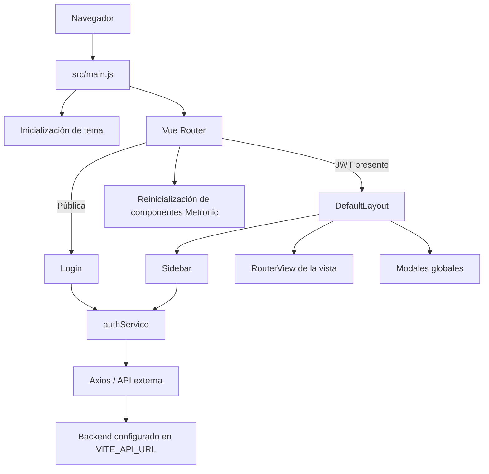
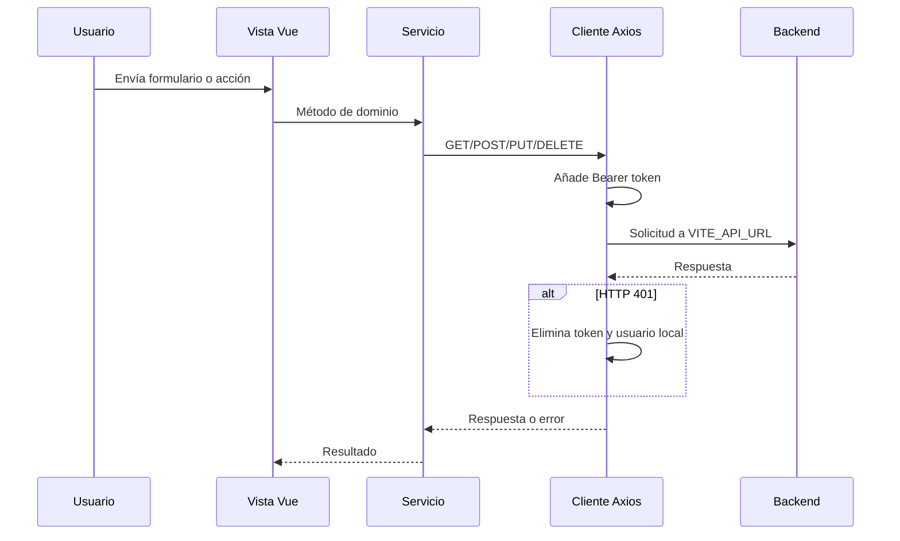

# Mapeo técnico del proyecto SEDALP

## 1. Alcance del análisis

Este documento describe la estructura, arquitectura, módulos, rutas y flujos observados en el repositorio. El inventario se obtuvo con `git ls-files --cached --others --exclude-standard`, por lo que solamente se analizaron archivos rastreados por Git o archivos no ignorados.

No se inspeccionaron `node_modules/`, `dist/`, archivos locales, logs, cobertura ni otros elementos excluidos por `.gitignore`. La compilación de verificación creó `dist/`, pero su contenido no forma parte de este análisis.

## 2. Resumen ejecutivo

SEDALP es una aplicación web SPA (Single Page Application) de frontend construida con Vue 3 y Vite. Usa Vue Router para navegación, Axios para comunicarse con una API externa, Tailwind CSS 4 y el tema Metronic 9/KTUI para la interfaz.

La aplicación organiza las páginas asociadas a Vue Router bajo `src/views/`, agrupadas por área funcional: autenticación, control de acceso, dashboard, comunicación, cuenta y perfil público. Las rutas se definen de forma centralizada en `src/router/index.js`; los servicios están en `src/services/`, los mocks en `src/mocks/` y la UI compartida en `src/components/ui/`. Solo el inicio y cierre de sesión están conectados explícitamente con la API; las pantallas de usuarios y roles operan con datos simulados en memoria, aunque existen servicios CRUD preparados para el backend. La sección de noticias se encuentra en una etapa inicial y por ahora solo muestra contenido de prueba.



## 3. Tecnologías y dependencias

| Capa         | Tecnología                                       | Uso observado                                        |
| ------------ | ------------------------------------------------ | ---------------------------------------------------- |
| Framework    | Vue `^3.5.40`                                    | Componentes SFC y Composition API con `script setup` |
| Construcción | Vite `^8.1.5`                                    | Servidor de desarrollo y bundle de producción        |
| Navegación   | Vue Router `^5.2.0`                              | Rutas públicas/protegidas y carga diferida           |
| HTTP         | Axios `^1.19.0`                                  | Cliente central y endpoints de autenticación/CRUD    |
| Estilos      | Tailwind CSS `^4.3.3`                            | Utilidades CSS, integrado como plugin de Vite        |
| UI           | Metronic 9, KTUI `^1.2.7`                        | Layout, menús, drawers, modales, iconos y widgets    |
| UI auxiliar  | Pickr, Vanilla Calendar Pro, ApexCharts estático | Recursos disponibles para widgets del tema           |
| Formato      | Prettier `3.9.5`                                 | Formateo de `src/`                                   |

Requisito declarado de Node.js: `^22.18.0` o `>=24.12.0`.

## 4. Árbol lógico

```text
sedalp-project-gadlp/
├── index.html                  # Documento HTML y punto de montaje #app
├── package.json                # Dependencias y scripts npm
├── vite.config.js              # Vue, DevTools, Tailwind y alias @
├── jsconfig.json               # Resolución del alias @/* -> src/*
├── .env                        # Define VITE_API_URL (valor no documentado)
├── public/
│   ├── css/                    # Bundles CSS precompilados del tema
│   ├── js/                     # Scripts precompilados de Metronic
│   ├── media/                  # Iconos, imágenes, avatares y recursos visuales
│   └── vendors/                # Dependencias estáticas del tema
└── src/
    ├── main.js                 # Arranque de la aplicación
    ├── App.vue                 # RouterView raíz
    ├── assets/
    │   ├── main.css            # Entrada de estilos
    │   └── metronic/           # Fuentes y estilos del tema
    ├── router/index.js         # Definición central de rutas y guardas
    ├── services/               # Instancia Axios y servicios de la API
    ├── mocks/                  # Datos simulados para desarrollo
    ├── utils/metronic.js       # Adaptador de Metronic al ciclo de Vue
    ├── layouts/                # Estructura visual de rutas protegidas
    ├── components/ui/          # Componentes visuales reutilizables
    └── views/                  # Páginas asociadas a las rutas
        ├── auth/
        ├── access-control/
        ├── dashboard/
        ├── comunication/       # Vista inicial de noticias
        ├── account/
        └── public-profile/
```

El repositorio contiene 995 archivos bajo `public/` y 122 bajo `src/`. La mayor parte corresponde a recursos de Metronic y no a lógica de negocio propia.

## 5. Arranque y ciclo de ejecución

1. `index.html` prepara el elemento `#app` y carga `/src/main.js`.
2. `main.js` llama a `initializeTheme()`, que determina modo claro/oscuro desde `localStorage`, un atributo HTML o la preferencia del sistema.
3. Se crea la aplicación Vue y se instala el router.
4. Cuando el router está listo, Vue se monta en `#app`.
5. Después del montaje se cargan secuencialmente scripts estáticos de Metronic:
   - `/js/core.bundle.js`
   - `/vendors/ktui/ktui.min.js`
   - `/vendors/apexcharts/apexcharts.min.js`
   - `/js/widgets/general.js`
6. Después de cada navegación, el router espera el siguiente render de Vue y recrea instancias de menú, dropdown, drawer, modal, tabs y scroll de Metronic.

Esta integración evita que los componentes imperativos del tema pierdan funcionalidad cuando Vue reemplaza el DOM durante la navegación.

## 6. Mapa de navegación

| URL                                | Nombre de ruta           | Vista                          | Acceso        | Título               |
| ---------------------------------- | ------------------------ | ------------------------------ | ------------- | -------------------- |
| `/login`                           | `login`                  | `LoginView.vue`                | Solo invitado | Iniciar sesión       |
| `/`                                | redirección              | `dashboard`                    | Protegido     | —                    |
| `/dashboard`                       | `dashboard`              | `DashboardView.vue`            | Protegido     | Dashboard            |
| `/usuarios`                        | `users.index`            | `UserManagementView.vue`       | Protegido     | Administrar usuarios |
| `/roles`                           | `roles.index`            | `RoleManagementView.vue`       | Protegido     | Roles y permisos     |
| `/news`                            | `news.index`             | `NewsView.vue`                 | Protegido     | Noticias             |
| `/account/integrations`            | `account-integrations`   | `IntegrationsView.vue`         | Protegido     | Integraciones        |
| `/public-profile/profiles/default` | `public-profile-default` | `PublicProfileDefaultView.vue` | Protegido     | Perfil público       |
| Cualquier otra                     | —                        | Redirección a `/`              | Según destino | —                    |

Las vistas se importan dinámicamente, de modo que Vite genera un chunk independiente por pantalla. El título del documento sigue el formato `<meta.title> | SEDALP`.

### Guardas

- Una ruta bajo `DefaultLayout` hereda `requiresAuth: true`.
- La autenticación se considera válida si existe `access_token` en `localStorage`; no se valida aquí su expiración.
- Sin token, una ruta protegida redirige a `login`.
- Con token, una ruta `guestOnly` redirige a `dashboard`.
- El metadato `permission` existe en usuarios y roles, pero no hay una guarda que lo aplique.

## 7. Layout protegido

`DefaultLayout.vue` compone cuatro piezas:

- `AppHeader`: cabecera móvil, logo y botón que abre el sidebar como drawer.
- `AppSidebar`: navegación principal, controles del tema y cierre de sesión.
- `AppMain`: `RouterView` de las páginas protegidas, área desplazable y footer.
- `AppModals`: monta permanentemente los modales de búsqueda, compartir perfil, dar reconocimiento y reportar usuario.

El sidebar determina estados activos a partir de `route.name` o prefijos de URL. Muchos bloques y enlaces aún conservan contenido demostrativo de Metronic.

## 8. Áreas funcionales

### 8.1. Autenticación

Responsabilidades:

- Formulario de correo y contraseña.
- Llamada `POST /auth/login`.
- Persistencia de `access_token` y, opcionalmente, `user` en `localStorage`.
- Manejo diferenciado de errores 401, 422, timeout y red.
- Redirección posterior a `dashboard`.
- Cierre de sesión con `POST /auth/logout`; el token local se elimina incluso si la petición falla.

`authService` también expone `GET /auth/me` y `POST /auth/refresh`, aunque no se observó su consumo.

### 8.2. Control de acceso

Contiene las pantallas de administración de funcionarios y roles/permisos.

`UserManagementView.vue` permite actualmente:

- Buscar y filtrar funcionarios por cargo.
- Registrar funcionarios en memoria.
- Distinguir Director, Responsable y Técnico.
- Asignar de una a tres de las siete regiones a cada técnico.
- Ver cobertura regional y técnicos asignados.

`RoleManagementView.vue` administra una colección local de roles y un catálogo local de permisos. Ambas vistas parten de `accessControlMock.js`; sus cambios desaparecen al recargar la página.

Existen `userService.js` y `roleService.js` con operaciones CRUD esperadas sobre `/users` y `/roles`, pero las vistas no los importan ni ejecutan.

### 8.3. Dashboard

Pantalla visual extensa basada en el demo de Metronic. Presenta tarjetas, métricas, gráficos y tablas estáticas. No se observaron llamadas a servicios ni estado de negocio externo.

### 8.4. Comunicación / noticias

La ruta protegida `/news` carga `src/views/comunication/NewsView.vue`. La vista es todavía un marcador de posición: no consume servicios, no administra estado y muestra únicamente un texto de prueba. Tampoco se observó un enlace hacia esta ruta en el sidebar, por lo que actualmente se accede escribiendo la URL o navegando de forma programática.

### 8.5. Cuenta / integraciones

Pantalla de integraciones basada en datos locales y estado reactivo. No se observó persistencia ni comunicación con APIs de terceros.

### 8.6. Perfil público

Vista de perfil reutilizada del tema, principalmente compuesta por contenido y recursos estáticos de demostración.

## 9. Comunicación con el backend



La instancia Axios define:

- URL base mediante `VITE_API_URL`.
- Cabeceras JSON.
- Timeout de 10 segundos.
- Interceptor de solicitud con `Authorization: Bearer <token>`.
- Limpieza de credenciales ante cualquier respuesta 401.

No se encontró backend, esquema de base de datos ni gestión global de estado dentro del alcance del repositorio. El backend es una dependencia externa.

## 10. Estado y persistencia

No se usa Pinia, Vuex ni otro store global.

- Autenticación: persistida en `localStorage` mediante `tokenService`.
- Tema: preferencia `kt-theme` en `localStorage`.
- Usuarios, roles, filtros, formularios e integraciones: estado local de componentes con `ref` y `computed`.
- Al recargar, solo sobreviven autenticación y preferencia visual.

## 11. Estilos y recursos visuales

`src/assets/main.css` importa los estilos fuente de Metronic y las cuatro familias de KeenIcons. Los componentes combinan clases Tailwind con clases semánticas `kt-*` del tema.

Hay dos conjuntos relacionados con Metronic:

- `src/assets/metronic/`: fuentes CSS/TypeScript que participan en el bundle de Vite.
- `public/`: bundles, vendors y medios servidos sin transformación.

Esto explica el gran volumen del repositorio y requiere cuidado para no editar código vendorizado al implementar lógica de negocio.

## 12. Hallazgos y riesgos técnicos

### Prioridad alta

1. **Los servicios de usuarios y roles tienen un import incompatible.** `src/services/api.js` exporta `api` como `default`, pero `userService.js` y `roleService.js` intentan importar `{ api }` como export nombrado. Hoy la compilación no falla porque esos servicios no forman parte del grafo usado por las vistas; al conectarlos, el build fallará hasta corregir el contrato de exportación/importación.
2. **Los permisos solo son metadatos.** Las rutas declaran `usuarios.ver` y `roles.ver`, pero la guarda únicamente revisa la existencia de un token. Cualquier usuario autenticado puede abrir ambas rutas desde el frontend.
3. **La validez del JWT no se comprueba.** Un token expirado sigue habilitando la navegación hasta que una petición reciba 401. Además, después de ese 401 se limpian credenciales, pero no existe redirección automática inmediata al login.

### Prioridad media

4. **CRUD todavía simulado.** Usuarios y roles tienen interfaces funcionales, pero trabajan exclusivamente con mocks y memoria local. Los servicios de API existentes aún no forman parte del flujo.
5. **Noticias aún es un marcador de posición.** La ruta existe y compila, pero la vista solo contiene texto de prueba y no está enlazada desde el sidebar. Además, el directorio se llama `comunication`, en lugar del término inglés `communication`, por lo que conviene fijar o corregir esa convención antes de ampliar el área.
6. **No hay pruebas del código de negocio.** Solo se observó una prueba dentro de los fuentes vendorizados de Metronic; no hay script `test` en `package.json`.
7. **No hay lint configurado.** Existe formato con Prettier, pero no una validación estática del código propio.

### Prioridad baja / mantenimiento

8. **Contenido demostrativo pendiente de depuración.** Dashboard, perfil, footer, modales y partes del sidebar conservan marcas, textos, enlaces y datos de Metronic.
9. **Título inicial genérico.** `index.html` usa `Vite App` hasta que termina la primera navegación y el router lo reemplaza.
10. **Peso visual considerable.** El build incluye CSS cercano a 488 kB sin comprimir y varias fuentes SVG entre aproximadamente 823 kB y 1,72 MB. Los recursos públicos del tema añaden más peso servido bajo demanda.

## 13. Verificación realizada

Se ejecutó `npm.cmd run build` con resultado exitoso:

- 145 módulos transformados.
- Vistas separadas en chunks por carga diferida, incluida `NewsView`.
- Bundle JS principal aproximado: 197,67 kB (63,31 kB gzip).
- CSS principal aproximado: 487,86 kB (62,67 kB gzip).

La compilación exitosa valida el grafo actualmente utilizado, pero no alcanza el problema de importación de `userService` y `roleService` porque esos archivos todavía no son consumidos por las vistas.

## 14. Mapa de responsabilidades recomendado para continuar

| Tipo de cambio                       | Ubicación natural        |
| ------------------------------------ | ------------------------ |
| Nueva página de un área              | `src/views/<area>/`      |
| Rutas de la aplicación               | `src/router/index.js`    |
| Acceso HTTP                          | `src/services/`          |
| Datos simulados                      | `src/mocks/`             |
| Componente exclusivo de un área      | `src/components/<area>/` |
| Componente reutilizable global       | `src/components/ui/`     |
| Estructura global de la aplicación   | `src/layouts/`           |
| Cliente HTTP transversal             | `src/services/api.js`    |
| Adaptación de librerías externas     | `src/utils/`             |
| Recursos propios procesados por Vite | `src/assets/`            |
| Recursos estáticos sin procesar      | `public/`                |

La dirección arquitectónica adoptada centraliza las rutas, separa las vistas de la lógica auxiliar y reserva `components/ui` para piezas compartidas. Los siguientes pasos recomendados son conectar las vistas de control de acceso con sus servicios, implementar autorización real en la guarda del router y retirar progresivamente el contenido de demostración de Metronic.
